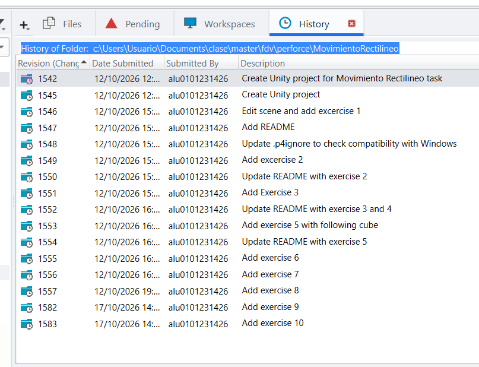
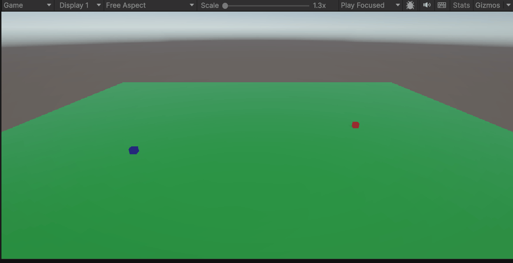
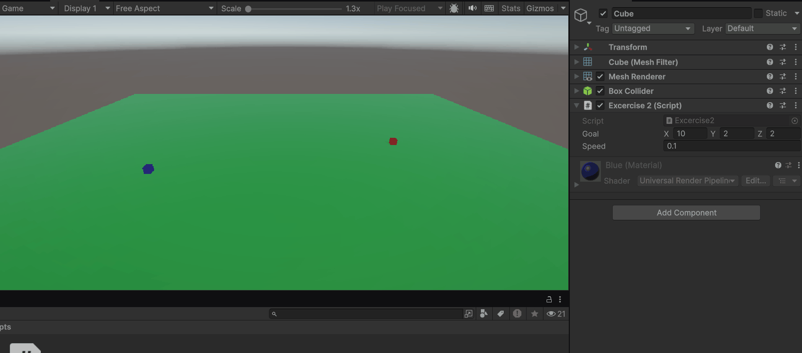
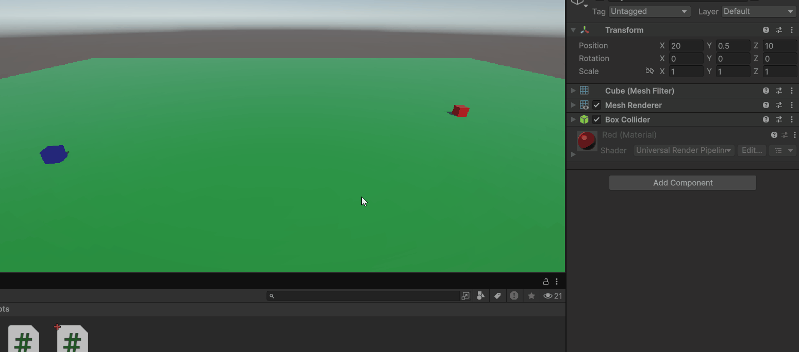
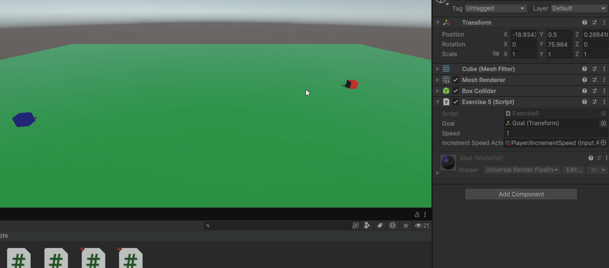
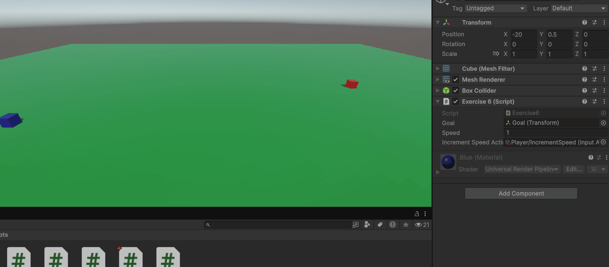
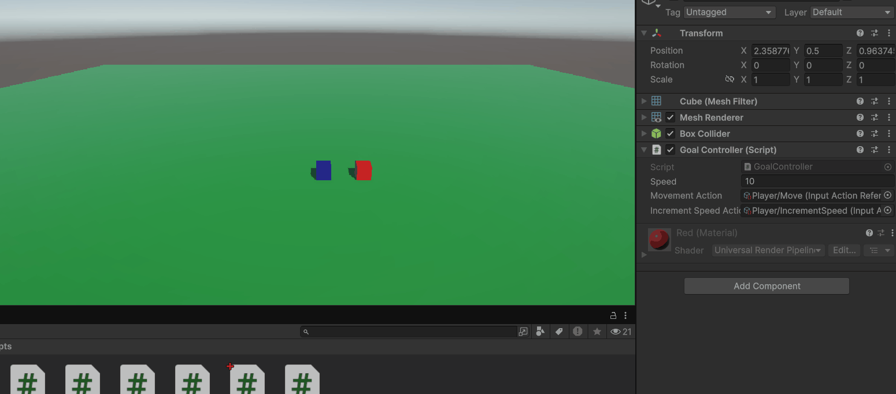
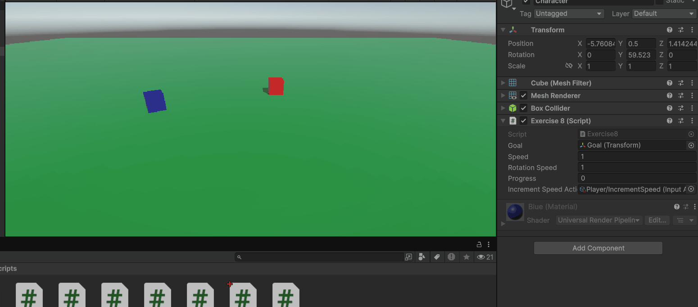
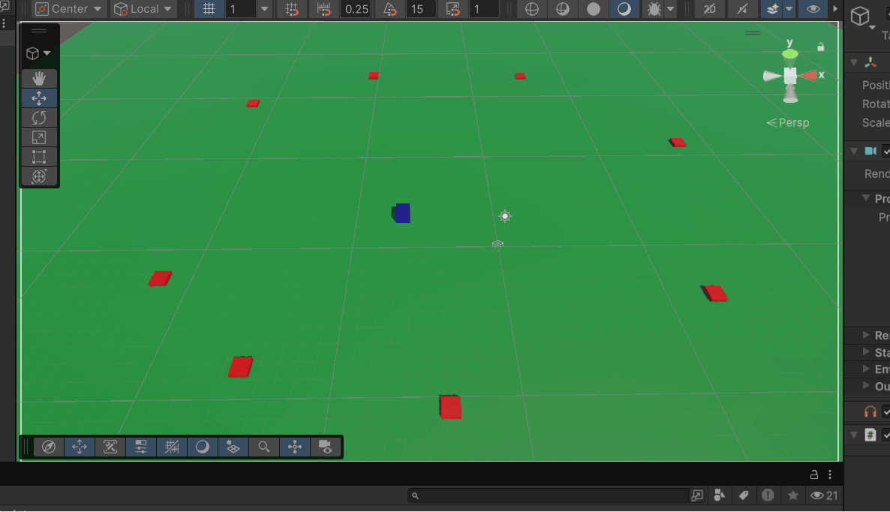
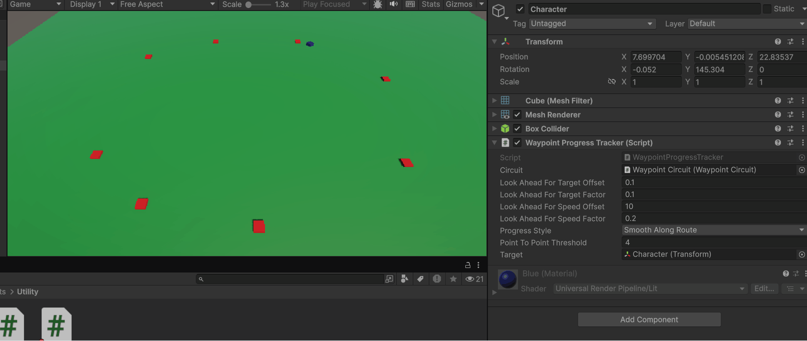

# Movimiento Rectilíneo
Note: this repository has been updated in Perforce. The final version is the one shown in GitHub.

## Exercise 1: flying as a plane.
Instead of multiplying the goal, it's added in each frame. This way, the increment is smoother and the cube flies more like a plane.

## Exercise 2: stable speed with framerate.
In this case, to avoid movements depending on the user's framerate, the speed is multiplied by `Time.deltaTime`.

## Exercise 3 and 4: objective instead of direction and debug ray
Note: Instead of using `LookAt` at start, I used it at `Update` to allow playing with face redirection in editor mode.

## Exercise 5: following character
I recycled the code from exercise 3 and added input actions for the movement.

## Exercise 6: alternative with forward vector
Same effect as exercise 5.

## Exercise 7: avoid jittering
Set accuracy. In the gif I used MoveTowards with a step calculated following Unity documentation: https://docs.unity3d.com/es/530/ScriptReference/Vector3.MoveTowards.html

## Exercise 8: Better rotation
The first gif does rotate first and then follow. The second gif rotates while follow. Both of them use Quaternion.Slerp to make a smooth rotation.

## Exercise 9: Waypoints
To store the waypoints I simulated a circular list using index and module. It creates a closed loop with the waypoints. I only store gameobject's tranforms, but if I would like to make changes like target material, I could reference the entire gameobject.

## Exercise 10: Unity's waypoints
This time I used the provided Unity scripts for the waypoint systems. Seems to work fine and even drift like a car game.

